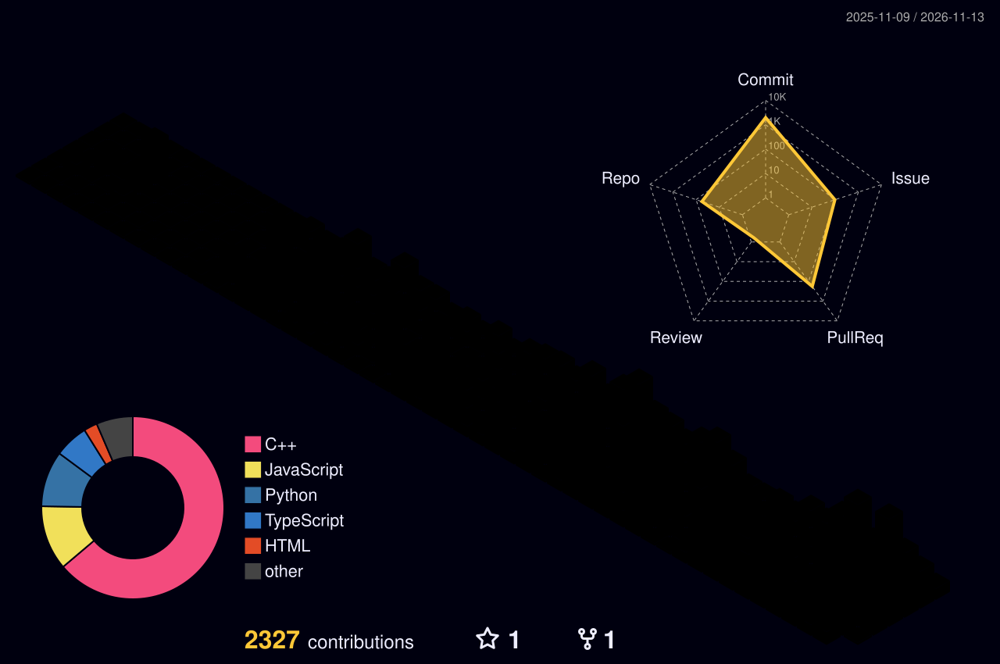

# Hi there, I'm Madhav Zanwar! 

  

  
  
  
  
  

## About Me

Hello! I'm **Madhav Zanwar**, an AI/ML student who enjoys turning ideas into working products — from real-time computer vision demos to full-stack platforms. I care most about projects that actually help people, especially around accessibility and social impact.

- 🔭 Building projects that combine AI/ML with practical, real-world use cases
- 🌱 Strengthening my fundamentals in **Python, C++, DSA, and Git/GitHub**
- 🧠 Focused on improving **problem-solving & logical thinking**
- 🤝 Open to **beginner-friendly open-source contributions**

 

---

## 🧠 Tech Stack & Skills

### 💻 Programming Languages

### 🎨 Frontend Development

### 🗄️ Databases & Cloud

### 🤖 AI/ML & Data Science

### 🛠️ Development Tools

---

## 🚀 Featured Projects

### 🌱 GreenYuva — Campus Climate Action App
🔗 [github.com/madhavzanwar/green-yuva](https://github.com/madhavzanwar/green-yuva) · 🌐 [Live Demo](https://greenyuva-e56f6.web.app)
**Tech Stack:** Flutter, Dart, Firebase, Supabase, Google Gemini
🏆 **2nd Place — Eco Vision, CiESA PCCOE (2026)**
- Mobile app that gets college students acting on climate: eco-tasks and quizzes to earn points, live local air quality, and a swap market for used items like textbooks
- **15 screens** built in Flutter for Android, iOS and web, with Firebase hosting and Supabase photo storage
- **Geofencing & GPS** show eco-tasks and swap listings only around the campus
- Pulls live **CPCB air-quality** data and **IMD weather alerts**; a Gemini tutor gives zero-waste tips

### 💰 FinPilot — Personal Finance Copilot
🔗 [github.com/madhavzanwar/finpilot](https://github.com/madhavzanwar/finpilot)
**Tech Stack:** Next.js, FastAPI, Firebase
🏆 **Finalist — Hack Matrix Hackathon, PCCOE (2026)**
- Finance assistant that reads a user's bank transactions, scores their financial health and predicts their balance for the next 90 days, then suggests what to change
- **Financial health score** built from 5 weighted pillars, including savings, liquid reserves and debt pressure
- Forecasts cash flow with a **Monte Carlo simulation of 1,000 runs**, giving a likely range instead of one guess
- Every answer is split into checked facts, predictions with confidence ranges, and actions ranked by impact

### 🎙️ Vocalyze — Anonymous Employee Feedback Platform
🔗 [github.com/madhavzanwar/vocalyze](https://github.com/madhavzanwar/vocalyze)
**Tech Stack:** Next.js, TypeScript, Supabase, pgvector, Google Gemini
🏆 **1st Place — Synapse 1.0, Finance domain, SIT Pune (2026)**
- Employees report workplace problems by text, voice note or a photo of a paper slip without revealing who they are; HR gets a dashboard to review and act on them
- **AI pipeline** translates 40+ languages, strips names and phone numbers, and tags theme, urgency and risk
- **Anonymity enforced in the database:** identity blocked, raw text deleted, audio never stored
- HR asks questions in plain English via **RAG search (pgvector)** that cites the exact feedback

---

## 🧩 LeetCode Stats

  

---

## 3D Contribution Calendar

  

---

## 📊 GitHub Stats

  
  

---

## 🌐 Connect With Me

  
  
  
  
  

